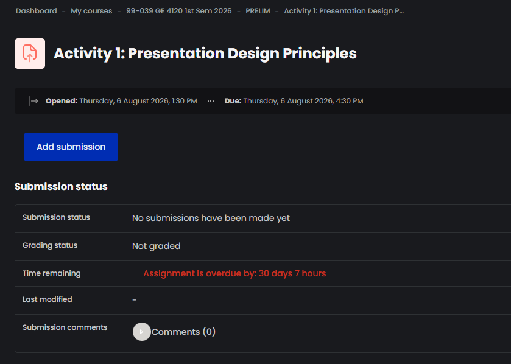

[⬅️ Back to Main Portfolio](../README.md)

# ⋆˚࿔ Activity 1: Presentation Design Principles

## 📌 Activity Description
This activity focuses on applying fundamental presentation design principles—visual hierarchy, contrast, alignment, repetition, and proximity—to transform plain slides into a clean, visually engaging, and well-structured presentation layout.

---

## 🎨 Applied Design Principles

- **Hierarchy:** Used distinct font sizes, bold weights, and strategic placement to guide the viewer's eye from the main heading down to supporting points.
- **Contrast:** Paired dark, legible typography against clean backgrounds (with accented highlights) to ensure readability and visual focus.
- **Alignment:** Aligned all text blocks, margins, and visual elements along consistent grid lines for a neat, professional appearance.
- **Repetition & Proximity:** Maintained uniform fonts, color accents, and spacing across slides while grouping related concepts together for effortless scanning.

---

## 🖼️ Output Preview

---

## 💭 What Have I Learned?

- **Key Concepts & Skills Gained:** I learned how visual hierarchy, contrast, alignment, repetition, and proximity work together to make presentations clear, structured, and engaging rather than overcrowded with text.
- **Challenge Faced & How I Solved It:** Balancing text density with white space without cutting out essential details was challenging, which I solved by summarizing lengthy paragraphs into concise bullet points and letting spacing separate ideas.
- **Future Application & Improvement:** I can apply these design principles when creating nursing case presentations, clinical reports, and patient education slides so critical health information is easy for audiences to understand at a glance.
